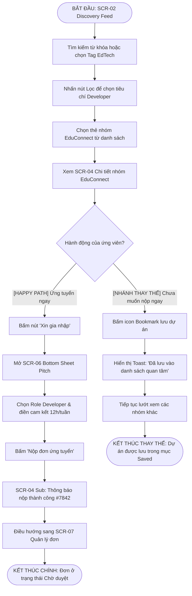
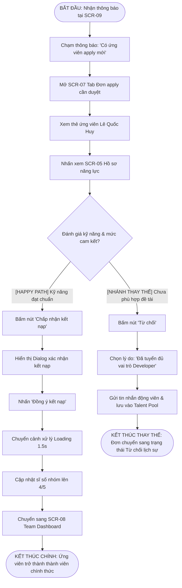
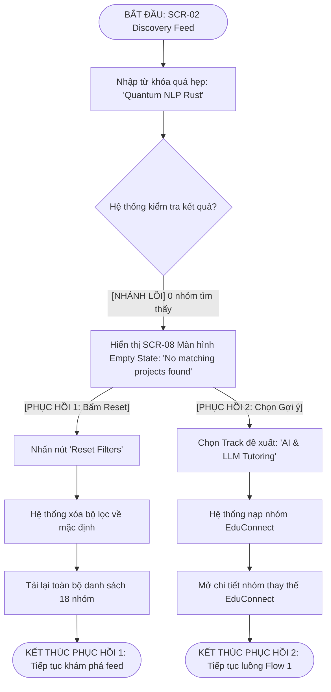

# Phân tích UX: Information Architecture & User Flows

## 1. Kiến trúc thông tin (Information Architecture - IA)

Ứng dụng quản lý ghép nhóm EXE được tổ chức theo cấu trúc phân tầng rõ ràng, tối ưu cho thao tác tìm kiếm và điều hướng nhanh trên di động:

```
App Root (Bottom Navigation & Main Screens)
├── [Màn hình 01] Onboarding & Lựa chọn vai trò (Cấp cao - Khởi động)
├── Bottom Navigation (Cấp điều hướng chính):
│   ├── [Màn hình 02] Trang chủ / Khám phá nhóm EXE (Home / Discovery Feed)
│   │   ├── [Màn hình 03] Modal Bộ lọc nâng cao & Bản đồ kỹ năng (Filter Sheet)
│   │   └── [Màn hình 04] Chi tiết nhóm dự án EXE (Project/Group Detail)
│   │       └── [Màn hình 06] Bottom Sheet Gửi đơn xin gia nhập (Apply/Pitch Sheet)
│   ├── [Màn hình 07] Quản lý lời mời & Đơn xin ghép nhóm (Applications / Requests)
│   │   ├── Tab: Yêu cầu đã gửi (Sent Requests)
│   │   └── Tab: Đơn apply cần duyệt (Incoming Applications - Dành cho Leader)
│   ├── [Màn hình 08] Bảng điều khiển nhóm chính thức (Team Workspace Dashboard)
│   └── [Màn hình 09] Thông báo hoạt động & Deadline (Notifications)
└── Màn hình phụ / Liên kết ngoài:
    └── [Màn hình 05] Hồ sơ năng lực thành viên (Member Profile & Skill Matrix)
```

### Danh sách 9 màn hình chuẩn thiết kế (Kích thước 360 × 800 dp):
1. **SCR-01 (Onboarding):** Chào mừng và chọn mục tiêu: "Tìm nhóm để tham gia" hoặc "Tạo nhóm & Tuyển thành viên".
2. **SCR-02 (Discovery Feed):** Danh sách các nhóm dự án đang tuyển, thanh tìm kiếm nhanh, tag chuyên ngành (Tech, Business, Marketing, Design).
3. **SCR-03 (Filter Modal):** Lọc theo lĩnh vực đề tài, vai trò còn thiếu, số giờ cam kết/tuần, múi giờ học.
4. **SCR-04 (Group Detail):** Thông tin dự án, số slot trống (ví dụ: 3/5), mô tả đề tài, danh sách thành viên hiện tại và vai trò còn thiếu.
5. **SCR-05 (Member Profile):** Hồ sơ cá nhân của ứng viên gồm Bio, Chuyên ngành, Kỹ năng cứng/mềm, Link portfolio/GitHub và độ tin cậy.
6. **SCR-06 (Pitch/Apply Sheet):** Form gửi lời mời xin vào nhóm: chọn vai trò ứng tuyển, viết lời giới thiệu ngắn (pitch).
7. **SCR-07 (Request Management):** Quản lý tình trạng đơn (Đang chờ duyệt, Được chấp nhận, Bị từ chối) và danh sách ứng viên xin vào nhóm.
8. **SCR-08 (Team Dashboard):** Khi đã ghép đủ nhóm: hiển thị 5 thành viên, vai trò phân công, link Zalo/Trello nhóm, đồng hồ đếm ngược deadline nộp danh sách.
9. **SCR-09 (Notifications):** Danh sách thông báo lời mời mới, kết quả duyệt, nhắc nhở hạn chót.

---

## 2. Các kịch bản luồng người dùng (User Flows)

### Flow 1: Ứng viên tìm kiếm và xin gia nhập nhóm phù hợp
* **Điểm bắt đầu:** Ứng viên tại Màn hình Khám phá (SCR-02).
* **Mục tiêu:** Tìm được nhóm EdTech phù hợp để xin gia nhập hoặc lưu lại đối sánh.
* **Điểm kết thúc:** 
  * Nhánh chính: Đơn ứng tuyển được gửi thành công (SCR-07).
  * Nhánh thay thế: Dự án được lưu vào danh sách Bookmark để xem xét sau.



---

### Flow 2: Trưởng nhóm xem xét đơn ứng tuyển và phản hồi
* **Điểm bắt đầu:** Trưởng nhóm nhận thông báo có ứng viên mới (SCR-09).
* **Mục tiêu:** Đánh giá hồ sơ ứng viên và đưa ra quyết định kết nạp hoặc từ chối.
* **Điểm kết thúc:** 
  * Nhánh chính: Ứng viên được kết nạp, sĩ số nhóm cập nhật lên 4/5 (SCR-08).
  * Nhánh thay thế: Đơn bị từ chối kèm lời nhắn và chuyển vào danh sách dự phòng.



---

### Flow 3: Lọc không có kết quả & Phục hồi tìm kiếm (Error & Recovery Branch)
* **Điểm bắt đầu:** Ứng viên tại SCR-02 Discovery Feed.
* **Mục tiêu:** Tìm kiếm nhóm dự án phù hợp; xử lý và phục hồi khi gặp lỗi không có dữ liệu.
* **Điểm kết thúc:** 
  * Phục hồi 1: Bộ lọc được xóa, quay lại danh sách 18 nhóm ban đầu.
  * Phục hồi 2: Chọn nhóm từ danh sách gợi ý đề xuất tương đương.



---

## 3. Bảng ánh xạ Flow sang các Màn hình (Screen Mapping Table)

| Tên màn hình | Ký hiệu | Flow 1: Ứng viên xin vào nhóm | Flow 2: Leader duyệt thành viên | Flow 3: Lỗi & Phục hồi |
| :--- | :--- | :---: | :---: | :---: |
| Onboarding & Chọn vai trò | SCR-01 | | | |
| Khám phá nhóm (Discovery Feed) | SCR-02 | **X** (Bước 1) | | **X** (Bước 1, Phục hồi) |
| Bộ lọc nâng cao (Filter Modal) | SCR-03 | **X** (Bước 2) | | **X** (Nhánh lỗi lọc) |
| Chi tiết nhóm (Group Detail) | SCR-04 | **X** (Bước 3) | | **X** (Nhánh lỗi hết slot) |
| Hồ sơ năng lực (Member Profile) | SCR-05 | | **X** (Bước 3) | |
| Bottom Sheet nộp đơn (Pitch Sheet) | SCR-06 | **X** (Bước 4) | | |
| Quản lý đơn (Request Management) | SCR-07 | **X** (Bước 5) | **X** (Bước 2) | |
| Bảng điều khiển nhóm (Team Dashboard) | SCR-08 | | **X** (Bước 5) | |
| Thông báo (Notifications) | SCR-09 | | **X** (Bước 1) | |
| Màn hình Empty / Error State | STATES | | | **X** (Hiển thị lỗi & Retry) |
